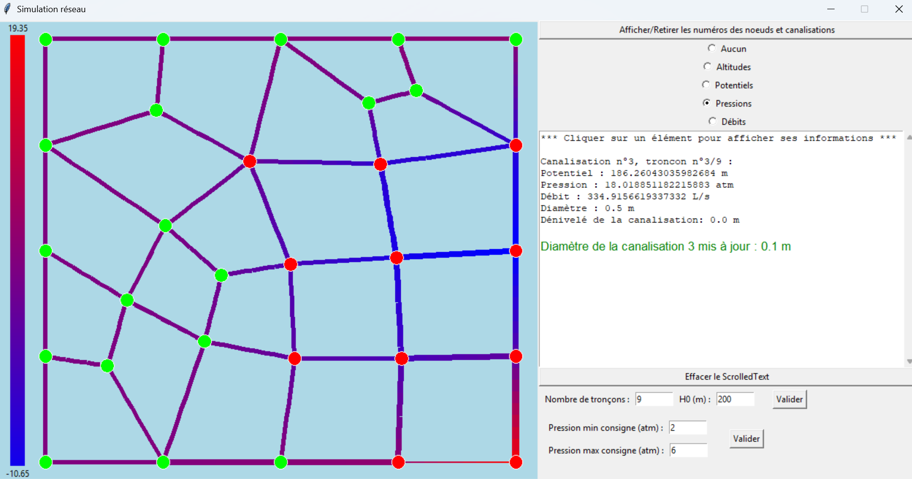

# Simulation de réseaux d'eau potable

**Calculer les charges hydrauliques, les débits et les pressions d'un réseau maillé, puis explorer l'effet des choix de dimensionnement.**

Projet P2I réalisé à l'INSA Lyon. Le logiciel associe une modélisation physique simplifiée, des méthodes numériques et une interface interactive.

**Python · NumPy · Tkinter · Matplotlib · Newton-Raphson · LDLᵀ**



Capture de l'interface du projet fournie avec le rapport. Elle montre l'affichage des pressions et la modification d'un diamètre.

## Ce que permet l'application

- Résoudre les équations hydrauliques d'un réseau maillé à partir d'une relation de Hazen-Williams.
- Calculer les charges hydrauliques par Newton-Raphson avec un solveur développé autour d'une factorisation LDLᵀ.
- Visualiser le réseau et afficher altitudes, charges hydrauliques, débits et pressions.
- Modifier dans l'interface la charge à la source, les diamètres et les consommations, puis recalculer les résultats.

## Démarche et résultat de l'étude

L'étude passe d'un modèle linéaire de vérification à une résolution non linéaire par Newton-Raphson, puis explore les effets de la géométrie et des paramètres du réseau.

Le rapport conclut que les configurations testées ne satisfont pas simultanément les consignes aux points hauts et bas avec une seule adduction. Il propose l'étude d'une deuxième adduction comme prolongement. Cette analyse des limites fait partie du résultat du projet.

Voir [le notebook détaillé](Rapport_P2I.ipynb) et [la démarche avec les illustrations originales](docs/demarche-et-resultats.md).

## Contribution de Robin PLACE

**Robin PLACE** a développé la partie logicielle du projet : représentation du réseau, résolution numérique par Newton-Raphson avec Jacobienne numérique, solveur LDLᵀ et interface interactive. Le projet relie calcul scientifique, programmation orientée objet et exploration visuelle des résultats.

## Essayer le projet

Environnement de référence : **Python 3.12**, avec Tkinter. Les versions utilisées pour la vérification sont fixées dans `requirements.txt`.

```sh
git clone https://github.com/Robin-Place/water-network-simulator.git
cd water-network-simulator
python -m venv .venv
```

Activer l'environnement avec `.venv\Scripts\Activate.ps1` sous PowerShell, ou `source .venv/bin/activate` sous Linux/macOS, puis :

```sh
python -m pip install -r requirements.txt
python lancer.py --demo
```

La démonstration utilise **le réseau du projet à six nœuds et sept canalisations**, fourni dans `data/demo/`. Les fichiers de connectivité, coordonnées, consommations et diamètres sont ceux transmis par Robin PLACE.

Un [aperçu numérique de ce réseau](docs/demo-reseau.png) est également fourni. Il est régénérable avec `python docs/generer_apercu.py`.

Pour calculer sans ouvrir de fenêtre :

```sh
python lancer.py --demo --sans-interface
```

Pour le réseau original fourni à la racine :

```sh
python lancer.py --data-dir . --network 2
```

La charge à la source vaut par défaut 80 m en démonstration et 200 m sur le réseau original. L'option `--charge-source` permet de la modifier. Voir [le format et les unités des données](docs/donnees.md).

Si Tkinter manque, vérifier son installation avec `python -m tkinter`. Il est fourni par l'installateur officiel Python pour Windows et peut nécessiter le paquet système `python3-tk` sous Linux.

## Organisation et validation

- `Main_tout_modele.py` : lecture du réseau et orchestration des calculs.
- `Classes_tout_modele.py` : nœuds, canalisations et tronçons.
- `Inversion_matrice_symetrique.py` : factorisation et résolution LDLᵀ, en Python et avec NumPy.
- `Affichage_tout_modele.py` : interface Tkinter.
- `lancer.py` : lancement sur le réseau de son choix.
- `Rapport_P2I.ipynb` : démarche scientifique, équations, solveur et exemple de résolution.
- `tests/` : contrôles du solveur, cas analytique et conservation des débits.

```sh
python -m unittest discover -s tests -v
```

Ces contrôles numériques ne constituent pas une validation complète de l'interface ni du modèle physique. La factorisation LDLᵀ évite une inversion explicite de matrice ; aucun gain de vitesse n'est revendiqué sans benchmark reproductible.

## Limites

L'étude reste pédagogique : régime permanent, pertes simplifiées, rugosité fixée et une seule source de charge imposée. Les pressions sont calculées à partir des tronçons discrétisés. Les seuils affichés sont des paramètres de l'étude, sans valeur de certification réglementaire.

Le solveur LDLᵀ ne réalise pas de pivotement ; les réseaux déconnectés et les cas de non-convergence nécessitent une gestion plus complète.

## Crédits et licence

Développement logiciel : **Robin PLACE**, dans le cadre du P2I à l'INSA Lyon. Merci à **Florent Prunier** pour le sujet et les données du projet.

Le code est disponible sous [licence MIT](LICENSE). Les données fournies dans le cadre du projet conservent leurs conditions d'utilisation propres ; elles ne sont pas relicenciées sous MIT.
