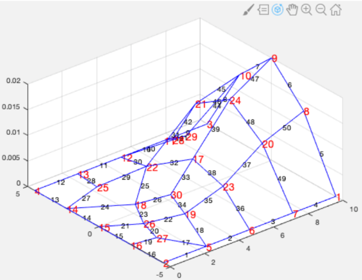

# Démarche et résultats du P2I

Le projet étudie un réseau maillé d'eau potable à partir de sa géométrie, de ses diamètres et des consommations imposées. L'objectif est de calculer les débits, charges hydrauliques et pressions, puis de tester des modifications de dimensionnement.

## Du modèle au programme

La démarche commence par un modèle linéaire, dont les équations de conservation aux nœuds conduisent à un système matriciel. Le nœud source possède une charge imposée ; les autres charges sont les inconnues.

Le modèle non linéaire introduit la relation de Hazen-Williams, avec un coefficient de rugosité fixé. Newton-Raphson corrige les charges à partir d'une Jacobienne calculée par différences finies. Le système linéaire de chaque itération est résolu avec NumPy ou avec le solveur LDLᵀ développé pour le projet.

La factorisation est détaillée dans le [notebook du projet](../Rapport_P2I.ipynb), avec les formules et les étapes de descente, résolution diagonale et remontée. La version du dépôt utilise des tableaux denses ; la vectorisation ne change pas à elle seule l'ordre de complexité de la factorisation.

## Explorer les choix de dimensionnement

La capture fournie avec le rapport montre l'interface réelle : choix de la grandeur affichée, inspection d'un tronçon, modification d'un diamètre, réglage de la charge source, nombre de tronçons et seuils de pression.

L'interface contient également une commande de suppression de canalisation. La prise en charge des réseaux devenant déconnectés reste une limite à vérifier avant de généraliser cette manipulation.

Cette représentation 3D est conservée comme illustration historique du projet. Elle ne remplace pas une vérification de ses axes et de ses unités à partir des données numériques du dépôt.

## Résultat de l'étude

Le notebook rapporte que les configurations explorées, faisant varier les diamètres, la charge source et le maillage, n'ont pas permis de respecter simultanément les consignes aux points hauts et aux points bas avec une seule adduction. Il propose l'étude d'une deuxième adduction comme prolongement.

Ce résultat donne au logiciel un rôle d'analyse : il permet de comprendre les contraintes de l'architecture étudiée. La deuxième adduction reste une piste, sans implémentation ni validation présentée dans le code actuel.

La vérification locale du réseau fourni porte sur 30 nœuds et 50 canalisations, avec une consommation totale de 672 L/s. Les tests contrôlent le bilan de la source avec les deux modèles et les deux solveurs. Ils ne constituent pas une validation physique exhaustive.

## Points à garder en tête

- Le notebook historique évoque une cible de 2 à 6 bars, alors que l'interface et le calcul de pression du code utilisent des atmosphères (`Pa / 101325`). Ces deux unités doivent être distinguées.
- La Jacobienne numérique du code utilise un incrément de `1e-8`.
- Le modèle suppose un régime permanent, des consommations fixes et une rugosité fixée.
- La comparaison de deux durées d'exécution sur un seul lancement ne constitue pas un benchmark statistique.
- La présence de pressions négatives dans une configuration doit conduire à discuter son interprétation physique, et non à présenter le réseau comme conforme.

## Documents

Le notebook et les deux captures ont été fournis par Robin PLACE pour documenter le projet. La copie originale du notebook est conservée dans le dossier local de références. La version publiée est adaptée aux chemins du dépôt et signale les précisions apportées à sa lecture.

